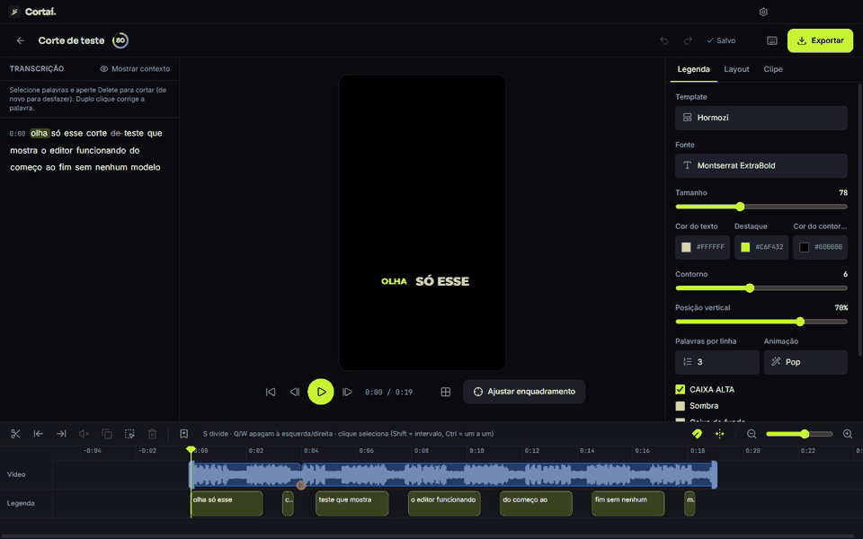

<p align="center"></p>

<h1 align="center">Cortaí</h1>

<p align="center"><b>Seus vídeos longos viram cortes virais. No seu computador, de graça, sem upload.</b></p>

<p align="center">
  <a href="https://github.com/kzen4/cortai/releases/latest"><b>Baixar para Windows</b></a> ·
  <a href="https://kzen4.github.io/cortai/">Site</a> ·
  <a href="https://github.com/kzen4/cortai/issues/new/choose">Relatar um problema</a>
</p>

<p align="center"></p>

O Cortaí pega um vídeo longo (aula, podcast, live, entrevista), acha os melhores momentos com IA, enquadra no rosto de quem fala e coloca legenda animada. Você revisa no editor e exporta cortes verticais prontos para Reels, TikTok e Shorts.

Tudo roda **no seu computador**: transcrição, IA e exportação. Nada vai para a nuvem, não tem mensalidade, marca d'água nem limite de vídeos.

## Instalar (sem terminal)

1. Baixe o `Cortai-Setup-<versão>.exe` em [Releases](https://github.com/kzen4/cortai/releases/latest) e dê dois cliques.
2. Se o Windows mostrar **"O Windows protegeu o computador"**, clique em **Mais informações → Executar assim mesmo**. O aviso aparece porque o instalador ainda não tem certificado digital pago.
3. Avance o instalador. Não pede senha de administrador.
4. Na primeira vez, o Cortaí confere o seu computador, recomenda um perfil e mostra cada componente como **pronto** ou **faltando**. Clique em **Instalar o que falta**: ele baixa e configura tudo sozinho, com progresso, pausar e retomar.

O app se **atualiza sozinho**: quando sai uma versão nova, ela é baixada em segundo plano e aparece um botão para reiniciar.

### Requisitos

| | |
|---|---|
| Sistema | Windows 10 ou 11, 64 bits (macOS e Linux depois) |
| Memória | 8 GB (16 GB recomendado) |
| Placa de vídeo | NVIDIA com 6 GB ou mais deixa tudo bem mais rápido; sem ela, funciona pelo processador |
| Espaço | De 6 a 16 GB, conforme o perfil (Leve, Equilibrado ou Máximo) |
| Internet | Só para baixar os componentes na primeira vez e para importar vídeo por link |

## Como usar

1. **Importe** um arquivo (ou cole o link de um vídeo seu).
2. O Cortaí **transcreve**, **escolhe os momentos** e mostra os cortes com nota.
3. Abra um corte no **editor**:
   - apague frases pela transcrição;
   - corrija a legenda com duplo clique na prévia;
   - ajuste o enquadramento;
   - divida, duplique, silencie e marque trechos na linha do tempo.
4. **Exporte** em MP4. A prévia é igual ao que sai no arquivo.

Atalhos do editor: aperte `?` dentro dele.

## Desenvolvimento

Precisa de Node.js 22 e [uv](https://docs.astral.sh/uv/).

```bash
npm install
npm run engine:setup   # motor de IA (Python 3.11) em engine/.venv
npm run dev            # abre o app (ou dê dois cliques em iniciar.bat)
npm run typecheck && npm test && npm run engine:test
npm run build && npm run e2e   # caminho feliz no app de verdade (Playwright)
npm run dist           # instalador em dist/
```

- Arquitetura e decisões: [`docs/ARCHITECTURE.md`](docs/ARCHITECTURE.md).
- Especificação: [`docs/SPEC.md`](docs/SPEC.md).
- Para publicar uma versão: suba o `version` do `package.json` e envie a tag (`git tag v0.1.0 && git push origin v0.1.0`). O GitHub Actions gera o instalador e publica nos Releases, e é de lá que o app instalado se atualiza.

## Licença

[AGPL-3.0](LICENSE). Você pode usar, estudar, modificar e redistribuir. Quem distribuir uma versão modificada, ou oferecê-la como serviço pela internet, precisa abrir o código também.
